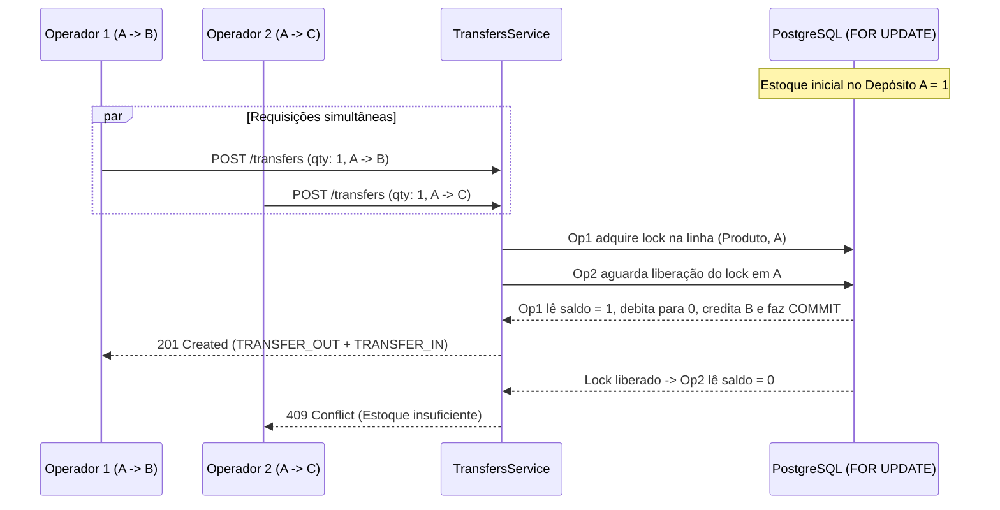

# Stoqia API 📦

> API REST para gerenciamento de estoque e transferências entre depósitos com tratamento de concorrência e transações ACID, construída com NestJS, TypeScript, PostgreSQL e Docker.

---

## 📋 Sobre o Projeto

O **Stoqia API** é um sistema de controle de estoque projetado para simular cenários críticos do mundo real. Diferente de um CRUD tradicional, o objetivo central do sistema é **garantir integridade absoluta dos dados**, prevenindo furos de estoque, saldos negativos e condições de corrida (*race conditions*) em requisições simultâneas.

### 🎯 Cenário Principal de Desafio
Imagine que existe apenas **uma unidade** de um determinado smartphone armazenada no **Depósito A**. Dois operadores ou sistemas externos solicitam, exatamente no mesmo milissegundo:
- **Operador 1:** Transferir 1 unidade do Depósito A para o Depósito B.
- **Operador 2:** Transferir 1 unidade do Depósito A para o Depósito C.

O **Stoqia API** utiliza **transações ACID** e **bloqueio pessimista no PostgreSQL (`SELECT ... FOR UPDATE`)**, garantindo que apenas uma operação seja efetivada e a outra receba um erro transparente de estoque insuficiente, preservando a consistência dos saldos.

---

## 🛠️ Stack Tecnológica

| Camada / Função | Tecnologia |
| :--- | :--- |
| **Linguagem** | TypeScript (Strict Mode) |
| **Runtime** | Node.js (v22+) |
| **Framework** | NestJS 12 |
| **Banco de Dados** | PostgreSQL 16 |
| **ORM & Migrations** | TypeORM |
| **Validação de Entrada** | Class Validator & Class Transformer |
| **Containerização** | Docker & Docker Compose |
| **Testes Automatizados** | Jest & Supertest (Unitários e E2E de Concorrência) |
| **Qualidade / Lint** | Oxlint (Type-Aware) & Prettier |
| **Versionamento** | Git, GitHub & Conventional Commits |

---

## 🔒 Como a Concorrência e a Integridade Funcionam

1. **Bloqueio Pessimista (`SELECT ... FOR UPDATE`):** toda alteração de saldo (`inbound`, `outbound`, `adjust` e `transfers`) trava a linha correspondente em `inventory_items` dentro de uma transação ACID até o `COMMIT` ou `ROLLBACK`, evitando leituras simultâneas do mesmo saldo (*race condition*).
2. **Prevenção de Deadlock (Ordenação Determinística):** ao transferir entre dois depósitos, os UUIDs de origem e destino são ordenados lexicograficamente antes da aquisição dos locks. Se duas requisições cruzadas (`A -> B` e `B -> A`) chegarem ao mesmo tempo, ambas travam os registros na mesma ordem, eliminando ciclos de espera.
3. **Idempotência Segura (`Idempotency-Key`):** `POST /transfers` aceita chave via header `Idempotency-Key` ou campo `idempotencyKey`, garantindo que *retries* de rede não debitem o estoque duas vezes — inclusive sob requisições paralelas via revalidação pós-lock e índice único (`UQ_transfers_idempotency_key`). Reutilizar a mesma chave com parâmetros diferentes retorna `409 Conflict`.
4. **Defesa em Profundidade no Banco:** além das validações na aplicação, o PostgreSQL impõe `UNIQUE ("product_id", "warehouse_id")`, `CHECK ("quantity" >= 0)`, `CHECK ("source_warehouse_id" <> "destination_warehouse_id")` e `ON DELETE RESTRICT`.



---

## 🏛️ Arquitetura de Software

A aplicação adota o padrão **modular idiomático do NestJS**, priorizando alta coesão, legibilidade, manutenibilidade e separação clara de responsabilidades:

```
src/
├── database/                         # Conexão TypeORM (DataSource) e Migrations
│   ├── migrations/                   # Migrations versionadas (products, warehouses, inventory, transfers)
│   └── data-source.ts                # Configuração centralizada do banco (CJS + ESM)
├── modules/                          # Módulos funcionais e independentes
│   ├── products/                     # Catálogo global de produtos (/products)
│   ├── warehouses/                   # Depósitos e centros de distribuição (/warehouses)
│   ├── inventory/                    # Saldos (inventory_items) e extrato auditável (stock_movements)
│   │   ├── dto/
│   │   ├── entities/
│   │   │   ├── inventory-item.entity.ts
│   │   │   └── stock-movement.entity.ts
│   │   ├── inventory.controller.ts
│   │   ├── inventory.service.ts
│   │   ├── inventory.service.spec.ts
│   │   └── inventory.module.ts
│   └── transfers/                    # Transferências concorrentes com lock ordenado e idempotência
├── app.controller.ts                 # Healthcheck inicial
├── app.module.ts                     # Módulo raiz agregador
└── main.ts                           # Bootstrap e ValidationPipe global
test/
├── app.e2e-spec.ts                   # Smoke test E2E da aplicação
└── transfers-concurrency.e2e-spec.ts # Testes E2E de concorrência real contra PostgreSQL
```

### Princípios Chave:
1. **Modularidade Coesa:** Cada módulo encapsula suas entidades, DTOs, controllers e services, expondo apenas o necessário via `exports`.
2. **Validação na Borda:** Nenhum dado inválido alcança o banco; o `ValidationPipe` global com `class-validator` barra dados inconsistentes antes de chegarem ao controller.
3. **Segurança de Identidade:** Todos os identificadores utilizam UUIDs v4 gerados nativamente pelo PostgreSQL (`gen_random_uuid()`) e validados na rota com `ParseUUIDPipe`.
4. **Imutabilidade e Soft Delete:** Produtos e movimentações utilizam inativação lógica (`is_active = false`), preservando a rastreabilidade e histórico contábil.
5. **Consistência Transacional:** Operações críticas de saldo operam sob transações com isolamento e controle de concorrência.

---

## 📡 Endpoints da API

### Módulo de Produtos (`/products`)

| Método | Rota | Descrição | Status de Sucesso |
| :--- | :--- | :--- | :--- |
| `POST` | `/products` | Cadastra um novo produto | `201 Created` |
| `GET` | `/products` | Lista todos os produtos cadastrados | `200 OK` |
| `GET` | `/products/:id` | Busca detalhes de um produto pelo UUID | `200 OK` |
| `PATCH` | `/products/:id` | Atualiza dados parciais do produto | `200 OK` |
| `DELETE` | `/products/:id` | Inativa um produto (*soft delete*) | `204 No Content` |

#### Exemplo de Payload para Criação (`POST /products`):
```json
{
  "name": "Smartphone Galaxy S24",
  "sku": "SM-GAL-S24",
  "description": "Aparelho 256GB Preto",
  "price": 4999.90
}
```

### Módulo de Depósitos (`/warehouses`)

| Método | Rota | Descrição | Status de Sucesso |
| :--- | :--- | :--- | :--- |
| `POST` | `/warehouses` | Cadastra um novo depósito | `201 Created` |
| `GET` | `/warehouses` | Lista todos os depósitos cadastrados | `200 OK` |
| `GET` | `/warehouses/:id` | Busca detalhes de um depósito pelo UUID | `200 OK` |
| `PATCH` | `/warehouses/:id` | Atualiza dados parciais do depósito | `200 OK` |
| `DELETE` | `/warehouses/:id` | Inativa um depósito (*soft delete*) | `204 No Content` |

#### Exemplo de Payload para Criação (`POST /warehouses`):
```json
{
  "name": "Depósito Central A",
  "code": "DEP-A",
  "location": "São Paulo - SP"
}
```

### Módulo de Estoque (`/inventory`)

| Método | Rota | Descrição | Status de Sucesso |
| :--- | :--- | :--- | :--- |
| `POST` | `/inventory/inbound` | Registra entrada de mercadoria em um depósito | `201 Created` |
| `POST` | `/inventory/outbound` | Registra saída de mercadoria validando saldo disponível | `201 Created` |
| `POST` | `/inventory/adjust` | Ajusta manualmente o saldo contado com motivo obrigatório | `201 Created` |
| `GET` | `/inventory` | Lista saldos atuais (filtros opcionais: `productId`, `warehouseId`) | `200 OK` |
| `GET` | `/inventory/movements` | Lista o extrato auditável (filtros: `productId`, `warehouseId`, `type`) | `200 OK` |
| `GET` | `/inventory/:id` | Busca detalhes de um item de estoque pelo UUID | `200 OK` |

#### Exemplo de Payload para Entrada (`POST /inventory/inbound`):
```json
{
  "productId": "11111111-1111-4111-8111-111111111111",
  "warehouseId": "22222222-2222-4222-8222-222222222222",
  "quantity": 10,
  "reason": "Carga inicial de estoque"
}
```

### Módulo de Transferências (`/transfers`)

| Método | Rota | Descrição | Status de Sucesso |
| :--- | :--- | :--- | :--- |
| `POST` | `/transfers` | Transfere estoque entre depósitos com lock ordenado (`FOR UPDATE`) e suporte a `Idempotency-Key` | `201 Created` |
| `GET` | `/transfers` | Lista transferências (filtros opcionais: `productId`, `sourceWarehouseId`, `destinationWarehouseId`) | `200 OK` |
| `GET` | `/transfers/:id` | Busca detalhes de uma transferência pelo UUID | `200 OK` |

#### Exemplo de Payload para Transferência (`POST /transfers`):
```json
{
  "productId": "11111111-1111-4111-8111-111111111111",
  "sourceWarehouseId": "22222222-2222-4222-8222-222222222222",
  "destinationWarehouseId": "33333333-3333-4333-8333-333333333333",
  "quantity": 1,
  "reason": "Remanejamento entre centros de distribuição",
  "idempotencyKey": "transfer-req-001"
}
```

---

## 🚀 Como Executar o Projeto

### Pré-requisitos
- [Node.js](https://nodejs.org/) v22+
- [Docker](https://www.docker.com/) e [Docker Compose](https://docs.docker.com/compose/)
- [Git](https://git-scm.com/)

### 1. Clonar o repositório
```bash
git clone https://github.com/geovanedevSW/stoqia-api.git
cd stoqia-api
```

### 2. Configurar Variáveis de Ambiente
Copie o arquivo de exemplo para criar o seu `.env`:
```bash
cp .env.example .env
```

### 3. Subir o Banco de Dados com Docker
Inicie o container do PostgreSQL em segundo plano:
```bash
docker compose up -d
```
Verifique se o container está saudável:
```bash
docker compose ps
```

### 4. Instalar as Dependências
```bash
npm install
```

### 5. Executar as Migrations
Aplique as migrações no banco de dados:
```bash
npm run migration:run
```

### 6. Iniciar a API em Desenvolvimento
```bash
npm run start:dev
```
A API estará acessível em: `http://localhost:3000`

---

## 🧪 Suíte de Testes

O projeto combina **36 testes unitários** (regras de negócio isoladas por módulo) com **testes E2E reais contra o PostgreSQL** comprovando comportamento sob concorrência:

- Disputa pela última unidade entre Depósito B e C via `Promise.all` (`201 Created` + `409 Conflict`, saldo final `0`).
- Estresse com 10 transferências paralelas disputando 3 unidades disponíveis (`3` sucessos, `7` conflitos).
- Transferências cruzadas simultâneas (`A -> B` e `B -> A`) sem *deadlock*.
- Retries paralelos com a mesma `Idempotency-Key` debitando apenas uma vez.

```bash
# Executar todos os testes unitários
npm test

# Executar testes em modo contínuo (watch)
npm run test:watch

# Verificar relatório de cobertura de código
npm run test:cov

# Executar testes End-to-End (requer PostgreSQL ativo via docker compose up -d)
npm run test:e2e

# Verificar lint com checagem de tipos
npm run lint
```

---

## 🌿 Padrão de Git e Commits

- Todo novo desenvolvimento é realizado em branches específicas de feature (`feature/<nome>`).
- As branches passam por validação via Pull Request antes do merge na branch `main`.
- Os commits seguem a convenção do **Conventional Commits**:
  - `feat:` Nova funcionalidade
  - `fix:` Correção de bug
  - `chore:` Configurações, dependências e tarefas de manutenção
  - `refactor:` Alterações de código sem mudança de comportamento externo
  - `test:` Criação ou ajuste de testes automatizados

---

## 📄 Licença

Este projeto é de uso educacional e de desenvolvimento profissional.
